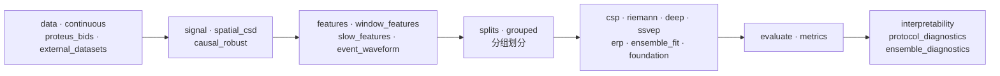

<div align="center">

# bci-bench

**One data contract, one split protocol, one metric definition — for every EEG experiment we run.**

共享评测内核：把散落在项目脚本与 notebook 里的数据接入、预处理、模型评测和诊断，收敛到一个可复用的 Python 包。

[](#安装--install)
[](#)
[](#测试--tests)
[](#)
[](#)

</div>

---

## 为什么需要它 / Why

同一条脑电数据，三个人写三套预处理，就会得到三个不可比的准确率——去趋势与否、陷波中心、滤波阶数、baseline 取哪一段，任何一处差异都足以让"提升 3 个百分点"变成噪声。

本项目把各 BCI 项目共用的部分抽成内核：

- **数据契约固定**：NPZ / `raw_stream + trial_records_json` / BIDS 视图三种输入，字段语义写死在 `data.py` 与 `proteus_bids.py`；
- **划分协议固定**：被试级、会话级、设备级分组划分统一由 `splits.py` / `grouped.py` 生成，禁止跨组泄漏；
- **指标口径固定**：balanced accuracy、macro F1、per-class recall 与分组 bootstrap 区间由 `metrics.py` 统一定义；
- **折内拟合**：标准化、CSP、特征选择等任何带状态的步骤只在训练折内拟合。

> 一句话：**让结论可复核，而不是可复述。**

---

## 能力边界 / Scope

| 做 | 不做 |
|---|---|
| 离线读取、质控、预处理、切片、特征、模型评测 | 设备驱动与在线采集（由各系统项目负责） |
| 分组交叉验证、OOF 概率汇总、配对 bootstrap | 声称某个模型"更好"——结论需协议支撑 |
| 基础模型接入与参数高效微调 | 猜测或补造通道映射、尺度、参考电极 |
| 诊断工具（置换重要性、消融、校准曲线） | 把诊断结果当作性能提升 |

仓库只保存代码、文档、测试与示例；**原始数据、处理后数据、模型权重、实验输出、日志一律不入库**。

---

## 安装 / Install

```bash
git clone https://github.com/periodgod/bci-bench.git
cd bci-bench
pip install -e ".[ml]"          # 常用：torch + scikit-learn + scipy
pip install -e ".[dev]"         # 开发：pytest
pip install -e ".[all]"         # 全量：含 mne / moabb / pyriemann / xgboost
```

按需安装可选依赖组：`signal` · `csp` · `ssvep` · `ml` · `peft` · `braindecode` · `eegmamba` · `geometric-csp` · `biot` · `eegpt` · `brainomni` · `domain-adaptation` · `xgb`。

---

## 快速开始 / Quick Start

### 命令行

```bash
wyu-bci-bench scan    --json outputs/scan.json            # 清点本地 NPZ 记录
wyu-bci-bench analyze --out outputs/offline_analysis      # 质量报告与图表
wyu-bci-bench bench   --out outputs/benchmarks --folds 5  # 试次级交叉验证
wyu-bci-bench oof-score   --help                          # 汇总已保存的分组 OOF 概率
wyu-bci-bench oof-compare --help                          # 两组 OOF 的配对比较
```

`analyze` / `bench` 支持协议开关：`--label-mode`（`all/mi/me/body/...`）、`--channel-mode`（`all/motor/motor11/central3`）、`--bad-channel-mode`（`off/auto/strict/manual`）、`--baseline-mode`（`pre_cue/epoch_start/none`）。

### Python API

```python
from wyu_bci_bench.data import load_dataset
from wyu_bci_bench.splits import grouped_kfold
from wyu_bci_bench.evaluate import cross_validate_simple_models

data = load_dataset("recordings/*.npz")
for train_idx, test_idx in grouped_kfold(data.groups, n_splits=5):
    ...  # 所有拟合步骤必须在 train_idx 内完成
```

端到端模板见 [`examples/proteus_loso_template.py`](examples/proteus_loso_template.py)（外层 LOSO + OOF 保存 + 协议报告）。

---

## 默认处理协议 / Default Protocol

| 环节 | 默认值 |
|---|---|
| 去趋势 | 线性去趋势 |
| 陷波 | 50 Hz |
| 带通 | 4–40 Hz，六阶 Butterworth，零相位 |
| Baseline | trial 内 `baseline_start_ms → cue_onset_ms` 的 pre-cue 均值校正 |
| 坏道 | 鲁棒 z / 平线 / 异常标准差 / 0.1–99.9% 鲁棒峰峰值，`auto` 模式 |
| 交叉验证 | 分层 K 折（默认 5 折），输出 accuracy、balanced accuracy、macro F1、混淆矩阵、per-class recall |

连续 `raw_stream` 走因果 SOS 滤波与连续流窗口缓存，用于在线链路的延迟/吞吐基准；**不含设备接入，也不做自动域适配**。

---

## 模块地图 / Module Map



| 层 | 模块 | 职责 |
|---|---|---|
| 接入 | `data` `continuous` `proteus_bids` `external_datasets` `dreyer` `eegmat` | NPZ / raw_stream / BIDS 读取、字段核验、时间轴对齐 |
| 质控 | `signal` `causal_robust` `protocol_diagnostics` | 坏道检测、因果滤波、协议诊断 |
| 表征 | `features` `window_features` `slow_features` `phase_slow` `event_waveform` `connectivity` `spatial_csd` | 频带功率、Hjorth、慢特征、事件相关波形、连接性 |
| 划分 | `splits` `grouped` `session_transductive` `session_causal` | 分层 K 折、被试/会话分组、LOSO |
| 模型 | `csp` `riemann` `deep` `nets` `sklearn_ml` `minirocket` `treeboost` `ssvep` `erp` `capsule` | 见下表 |
| 适配 | `adaptation` `calibration` `fewshot` `readout` `foundation/*` | EA/CORAL/MMD/DANN/AdaBN、温度缩放、k-shot、冻结读出、PEFT |
| 评测 | `metrics` `evaluate` `submission` `registry` `viz` | 指标、交叉验证、提交打包、实验登记、可视化 |

### 模型族

| 族 | 入口 | 代表实现 |
|---|---|---|
| 经典基线 | `sklearn_ml` `simple` | 逻辑回归、LDA、SVM、随机森林、XGBoost |
| 空间滤波 | `csp` | CSP、FBCSP + SVM/LDA、几何 CSP |
| 黎曼几何 | `riemann` | 协方差切空间 + MDM / 逻辑回归 |
| 时序核方法 | `minirocket` | MiniRocket |
| 深度模型 | `deep` `nets` `deep_models` | EEGNet、CapsuleNet、M1/M2、FBCNet、ShallowFBCSPNet |
| Braindecode 网络 | `braindecode` 依赖 | Deep4Net、EEGConformer、ATCNet、TCN、EEGTCNet、EEGInceptionMI、EEGNeX、EEGITNet |
| SSVEP | `ssvep` | CCA、FBCCA、TRCA/eTRCA、TDCA |
| ERP | `erp` `event_waveform` | xDAWN + LDA、类模板投影、低频波形 |
| 集成 | `ensemble_fit` `ensemble_diagnostics` | hard voting、专家门控 |
| 自监督 | `ssl` `pretraining` `pretraining_masks` `mae_downstream` | 掩码重建、对比学习、下游评测 |

---

## 基础模型适配 / Foundation Adapters

适配器只负责**核验合同 + 冻结特征 + 受控微调**，不替使用者猜通道或尺度。

| 模型 | 前置条件 | 入口 |
|---|---|---|
| **BIOT** | `.[biot]`，官方源码、匹配 checkpoint、严格有序 16/18 双极导联名、200 Hz、10 s 窗 | `foundation.biot.extract_features` |
| **EEGPT** | `.[eegpt]`，作者源码、含 `target_encoder.*` 的 safetensors、58 路官方通道名、4 s EEG | `foundation.eegpt.extract_features` |
| **BrainOmni** | `.[brainomni]`，官方权重与 tokenizer | `_third_party/brainomni` |
| **CBraMod** | token 级合同核验 | `tests/test_cbramod_tokens.py` |

微调方式：从头训练、编码器初始化、全量微调、冻结线性探测、残差 adapter、LoRA / DoRA / PiSSA / AdaLoRA。方法来源与未支持项见 [`docs/foundation_finetuning_methods.md`](docs/foundation_finetuning_methods.md)。

> `amplitude_scale` 等尺度参数必须由数据集预处理方案显式指定——上游预训练数据混合了不同来源，本库不设统一默认值。

---

## 目录结构 / Layout

```
bci-bench/
├── src/wyu_bci_bench/     # 核心包（数据、信号、模型、评测、基础模型适配）
│   └── _third_party/      # 带许可证与上游信息的第三方实现
├── tests/                 # 40 个测试模块（数据契约、协议、适配器）
├── docs/                  # 架构、模型目录、协议、诊断说明
├── examples/              # 端到端模板（LOSO、机械臂录制分析）
├── explorer/              # 结果浏览工具
├── notebooks/             # 探索性分析
└── scripts/               # 批量实验入口
```

## 测试 / Tests

```bash
pytest -q                       # 全量
pytest tests/test_biot.py -q    # 单模块
```

测试覆盖数据合同、划分不泄漏、指标一致性、第三方适配器的通道/尺度核验——**适配器在通道名或采样率不匹配时必须报错，而不是静默降级**。

## 文档 / Docs

- [`docs/ARCHITECTURE.md`](docs/ARCHITECTURE.md) — 分层设计与模块职责
- [`docs/model_catalog.md`](docs/model_catalog.md) — 模型清单、可运行状态与当前缺口
- [`docs/EEG_FOUNDATION_PROTOCOLS.md`](docs/EEG_FOUNDATION_PROTOCOLS.md) — 基础模型评测协议与证据边界
- [`docs/DATA_DIAGNOSTICS.md`](docs/DATA_DIAGNOSTICS.md) — 数据诊断口径
- [`ACCESS_POLICY.md`](ACCESS_POLICY.md) — 数据与代码使用边界

## 在项目群中的位置

本仓库是共享内核，其余项目通过 `pip install -e ../bci-bench` 引用，不复制代码：

[bci-foundation-model](https://github.com/periodgod/bci-foundation-model) ·
[bci-arm-robot](https://github.com/periodgod/bci-arm-robot) ·
[bci-visual-app](https://github.com/periodgod/bci-visual-app) ·
[bci-mer](https://github.com/periodgod/bci-mer) ·
[bci-rehab](https://github.com/periodgod/bci-rehab) ·
[bci-proteus](https://github.com/periodgod/bci-proteus) ·
[bci-omnieeg](https://github.com/periodgod/bci-omnieeg)

---

<div align="center"><sub>Wuyi University · BCI Group　|　代码与文档公开，数据与权重不随仓库分发</sub></div>
